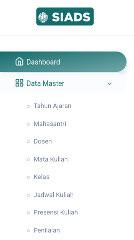

# Registrasi SIADS

## Registrasi

Untuk mendapatkan email dan password, maka Administrator harus mendaftarkan user tersebut, dosen atau mahasantri, dari panel admin.

Jika user baru tersebut adalah Dosen, maka dari menu **Data Master** lalu ke **Dosen**, kemudian daftarkan akun dosen sesuai dengan data dirinya.

Jika user baru tersebut adalah Mahasantri, maka dari menu **Data Master** lalu ke **Mahasantri**, kemudian daftarkan akun mahasantri sesuai dengan data dirinya.

## Lupa Password

Jika lupa password, maka user tersebut harus melaporkan ke Administrator untuk diubah secara manual dari panel admin.