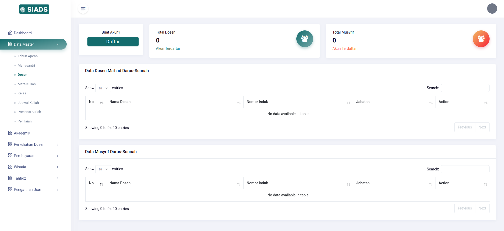
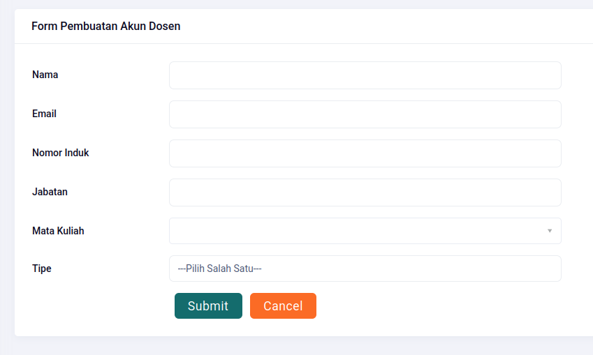
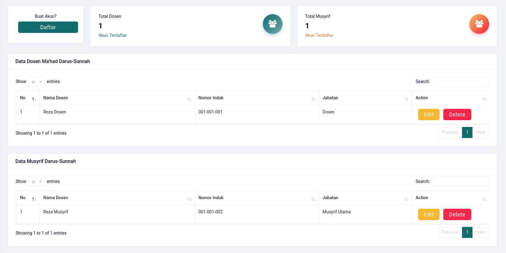

# Pendataan Dosen

## Daftar Dosen

Untuk melihat daftar dosen yang terdata di SIADS, bisa diakses pada menu **Data Master** lalu submenu **Dosen**.

## Pendaftaran Akun Dosen

Untuk mendaftarkan akun Dosen, maka klik tombol **Daftar**, lalu isi detail yang dipinta.

| Kolom       | Deskripsi                                                              |
| ----------- | ---------------------------------------------------------------------- |
| Nama        | Nama lengkap dosen                                                     |
| Email       | Email dosen                                                            |
| Nomor Induk | Nomor Induk Dosen. Bisa NID dari pemerintah atau internal Darus Sunnah |
| Jabatan     | Jabatan yang dipangku dosen                                            |
| Mata Kuliah | Daftar mata kuliah yang diampu oleh dosen                              |
| Tipe        | Dosen ini berupa dosen atau _musyrif_.                                 |

Sebagai langkah awal, seluruh password akun dosen baru adalah **password**. Tolong himbau setiap dosen untuk langsung mengubahnya dari dalam panel akunnya masing-masing melalui menu **Ubah Kata Sandi**.

## Contoh

Berikut contoh jika sudah ada data dosen.

